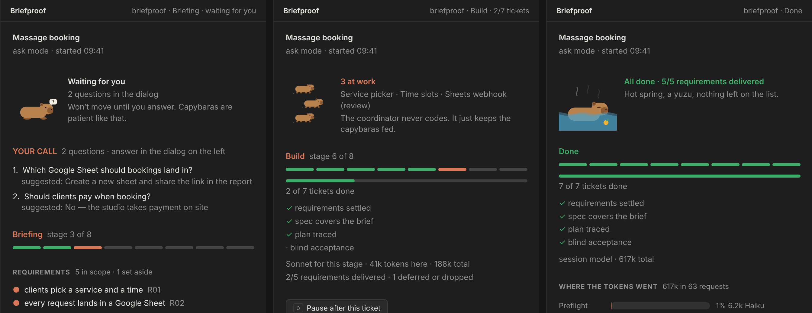
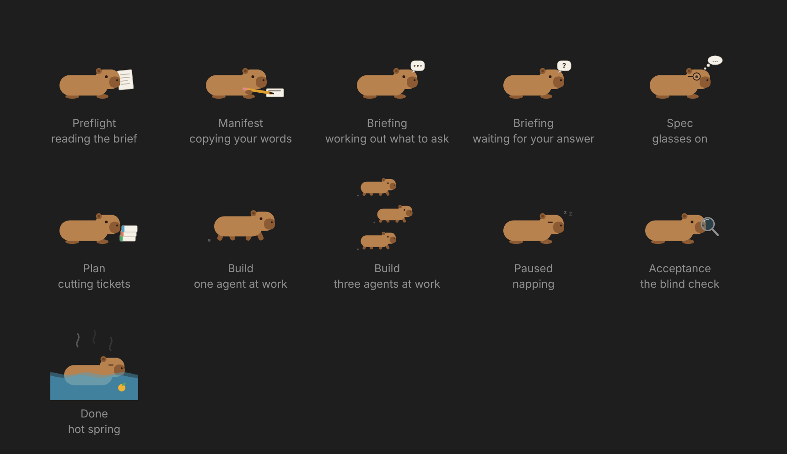

# Briefproof

Your AI agent builds exactly what you asked for, and proves it.



<!-- video: edit this README on github.com and drag briefproof-explainer.mp4 onto this line;
     GitHub hosts it outside the repo and the link it inserts plays inline. Then delete this comment. -->

## Why I built this

AI agents are good at building things. They are also surprisingly good at
declaring something finished when it isn't. A requirement gets paraphrased in
the spec, quietly dropped in the plan, and by the time the agent says "done"
nobody can say what happened to it.

For about a year I've built every project the same way: write the brief in
plain words, turn it into requirements, a spec and tickets, let the agent build,
then have a *separate* agent check the result against the original brief. If
something is missing, fix and check again. The agent can't call it done while
something you asked for is still missing.

That workflow lived as a set of prompts I wrote for myself. When Claude Code
shipped mods, I turned it into a plugin with a pane you can watch, and here it is.

**Briefproof runs in Claude Code only**: the terminal, or the desktop app's Code
tab in a local session. In plain chat the skill shows up but the pane and the
ledger don't, because those are a Claude Code mod.

## Install

In a Claude Code terminal session:

```
/plugin install briefproof --marketplace dmitribogatenkov/briefproof
```

Answer `y` to add the marketplace and press Enter for the user scope. That's
it. There is nothing else to install: no Python, no Node, no config. Everything
runs inside Claude Code, and the plugin works in every project from then on.
You need a Claude Code version with mods (October 2026 or later).

## Use

Open Claude Code in an empty folder (or an existing project) and describe what
you want:

```
/briefproof:build A booking page for a small massage studio: clients pick a service and a time, and every request lands in a Google Sheet
```

A few more ways to start a run:

```
/briefproof:build brief.md          # a longer brief in a file
/briefproof:build auto brief.md     # no questions; every decision listed in the final report
/briefproof:build                   # resume an interrupted run
```

The pane opens on its own when a run starts.

## How it works

Your brief becomes numbered requirements, quoted word for word. Briefproof asks
you the questions the brief leaves open (one round, suggested answer first),
writes a spec and a plan, then builds each ticket in a fresh subagent. At the
end, another agent that has only seen your original brief checks the finished
project against it, and you get a plain-language report.

A few rules make this trustworthy, and I didn't bend any of them:

| Rule | Why it's there |
|---|---|
| **Requirements are quoted, never paraphrased** (`R01…`) | Paraphrase drifts. Each rewrite loses a little, and by the spec a requirement can simply be gone. Nothing leaves the list without your own words saying why. |
| **The checks are independent** | A fresh subagent compares the spec, and later a clean clone of the finished project, against *only* your brief. Authors check their intent; a stranger checks the text. |
| **The coordinator never writes code** | Each ticket runs in its own fresh context, so the main session stays sharp from the first question to the final report. |
| **Boundaries come before tickets** | `interfaces.md` is written from the whole spec, so the first ticket doesn't quietly decide the architecture. |
| **Review where it pays** | Foundation and risky tickets get a review, plus one pass over the whole branch. At most two fix rounds, so the cost stays predictable. |
| **Gates the agent can't talk its way past** | The run ledger refuses to mark a gate passed while it still has a problem: an open requirement, a ticket that traces to nothing. |
| **Safe by default** | It never asks for secret values, and always asks before deploying, paying, sending or deleting. |

Two modes: `ask` (the default; asks only what the brief leaves open) and `auto`
(asks nothing and lists every decision it made in the final report).

## The pane

The first version of this pane was a wall of scrolling text. My daughter looked
at it and asked what the computer was doing, and I didn't have a good answer.
So now there's a capybara, and it tells you.



- **One capybara per stage.** It reads your brief, copies your words with a
  pencil, works out what to ask, puts glasses on for the spec, stacks tickets
  for the plan, holds a magnifying glass for the blind check, and soaks in a
  hot spring when the run is done. During the build it runs, one capybara per
  ticket in progress. While it waits for you it holds up a `?`; when you pause,
  it naps.
- **Questions stay where you expect them.** Clarifying questions use Claude
  Code's own dialog, with the suggested answer first. The pane mirrors them
  while the dialog is open, so you can see what's being asked at a glance.
- **Steer requirements in your own words.** Pick a requirement to defer or drop
  it; the pane asks why, in your words, and that's what the ledger keeps. Type a
  new requirement and it lands in the brief under "Additions" and in the plan.
- **Pause after this ticket.** The ledger refuses to start new tickets while
  you're paused, so the agent can't run past you.
- **It tells you when it needs you.** A desktop notification when questions are
  waiting, a short message as each ticket finishes.

The status line reads `briefproof · Build · 3/7 tickets`, with `· waiting for
you` or `· paused` when that's the case.

### Pick a model per stage

Not every stage needs the biggest model. Copying your brief into quotes is
mechanical; the blind acceptance check is the whole promise. So each of the
eight stages can run on a model of your choice, and the plugin enforces it on
every request made during that stage, the agent's own and its subagents'.

```
/plugin configure briefproof@briefproof
```

(In the desktop app: **+ > Plugins > Manage plugins > Briefproof > Configure**.)
Each stage is a picker: `session` (the model your session runs on, the
default), `fable`, `opus`, `sonnet` or `haiku`. You can change it mid-run; the run lives
in the ledger file and carries on.

The split I use when I want to save:

| Stage | Model | Why |
|---|---|---|
| Preflight, Manifest | haiku | mechanical: copy the brief, split it into quotes |
| Briefing, Spec, Plan | session | this is where the judgment is |
| Build | sonnet | executors write code from a tight ticket |
| Acceptance | session | the blind check is the whole promise |
| Done (the report) | haiku | summarization |

The pane shows the model in force and the tokens spent so far. When the run is
done it draws a bar per stage, so you can see where the tokens went and which
model answered. The final report carries the same table, and
`.briefproof/state.json` keeps it under `usage`.

### The ledger

The mod registers one tool, `state`, and it's the only way the agent can record
progress. It validates every change (no dropping a requirement without your
words, no passing a gate with open problems, no new ticket while paused), writes
`.briefproof/state.json`, and never needs your approval because it only touches
its own folder.

## Contributing

```bash
git clone https://github.com/dmitribogatenkov/briefproof
claude --plugin-dir ./briefproof          # load it from the folder for one session
claude plugin test ./briefproof           # 13 tests against an in-memory engine
```

Pull requests are welcome. The screenshots in `docs/` are rendered from the
mod's own SVG into a mock of the pane layout; if you have a capture from a real
run, I'd rather use that.

## Layout

```
.claude-plugin/plugin.json, marketplace.json
skills/build/SKILL.md            the orchestrator (/briefproof:build)
skills/build/prompts/            executor + reviewer, coverage (G2), acceptance (G4)
hooks/register.tsx               the mod: state tool, live pane, capybaras, model routing
types/index.d.ts                 the run-state contract
tests/                           claude plugin test .
docs/                            images for this README
```

## What a run leaves in your project

```
.briefproof/state.json        run state (written only by the state tool)
.briefproof/brief.md          your words, secrets redacted; later wishes under "## Additions"
.briefproof/spec.md           the specification
.briefproof/interfaces.md     boundaries, shared types, what each finished ticket built
.briefproof/tickets/NN-*.md   one per ticket
AGENTS.md                     project memory (unless you already have one)
```

MIT © 2026 Dmitri Bogatenkov
